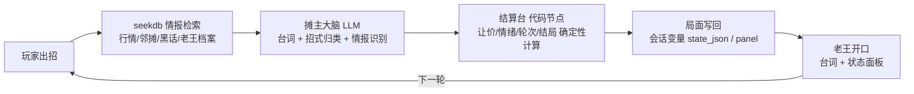

# 01 · 创意与玩法设计

> 2026 OceanBase 大赛 · Dify 题 · 《早市风云 · 老王菜摊》
> 一句话：**6 轮之内，把老王的黄瓜从 12 元/斤砍到 8 元以下。**

## 1. 为什么是这个作品

题目要求"带 Dify 做一个好玩的智能应用"，参考方向里有"对话与策略挑战"。我们选了一个每个人都能秒懂、又极少有人做成 AI 应用的场景——**跟菜市场摊主砍价**：

- 目标清晰（8 元/斤）、轮次有限（6 轮）、输赢分明（成交 / 掀摊 / 超时），天然有游戏张力；
- 玩家自由发挥说话，LLM 扮演有脾气有底价的角色，每次对话都不一样；
- 想赢必须"讲理"——行情、邻摊报价、进货价这些**情报散落在知识库里**，检索（seekdb）是核心玩法而不是摆设；
- 摊主**记得你用过什么招**，重复出招会被当面拆穿——跨轮状态是核心玩法而不是摆设。

## 2. 玩法循环

- **玩家可见**：老王的台词、价签播报、状态面板（现价 / 情绪条 / 轮次 / 招式统计 / 情报）。
- **系统内部**：`conversation.state_json` 保存对局状态，「变量赋值」节点每轮写回，下一轮传回结算台；上一轮的面板喂给摊主大脑接梗。

## 3. 结局与成就

| 结局 | 条件 | 成就 |
|---|---|---|
| 🎉 成交 | 价格 ≤ 8.0 元/斤 | 情报王 / 一刀见血 / 持家有道 |
| 🎉 友情价成交 | 6 轮耗尽但 ≤ 8.5 元/斤 | 🕊 收摊友情价 |
| 💥 掀摊 | 老王情绪 < 20 | 🥊 嘴强王者（隐藏成就） |
| ⏰ 超时 | 6 轮耗尽且 > 8.5 元/斤 | 明儿请早 |

结束后随便再说一句，自动开新局（可重玩）。

## 4. 数值设计（全部确定性，见 `build/settle_code.py`）

| 招式 | 让价系数 | 情绪 | 点评 |
|---|---|---|---|
| 对比邻摊 | 1.30 | -6 | 报出具体摊名+价格才有效，一局别超两次 |
| 挑刺 | 1.10 | -4 | 说行话有效，对老王家的尖货慎用 |
| 走人威胁 | 1.40 | -12 | 第一次最猛，重复效果衰减 40%/次 |
| 套近乎 | 0.90 | +8 | 不砍价但攒情绪，攒满触发抹零 |
| 卖惨 | 0.80 | +2 | 缓冲招 |
| 硬砍 | 0.50 | -8 | 只会掉情绪不省钱 |
| 试探行情 | 0.55 | 0 | 安全但低效 |
| 认错缓和 | 0.70 | +6 | 聊僵了用来回血 |

- 每轮让价 = 剩余空间 × 0.35 × 招式系数 × 重复衰减（-40%/次，下限 ×0.25）；
- **套出进货价**（情报命中）后每轮多让 0.15，首次命中再一次性冲击 -0.2；
- 情绪 < 35 摊主收紧口袋（让价 ×0.6），< 20 直接掀摊；≥ 85 且第 3 轮起每轮抹零 0.3；
- 底价 7.2 元/斤藏在知识库《今日特价与暗号》里——**读文档就能赢，这就是"检索有用"的证明**。

## 5. 与评分维度的对应

| 维度 | 本作品的回答 |
|---|---|
| 创意 | 把大模型放进一个"人人砍过价"的具体博弈，而不是又一个聊天助手 |
| 趣味与互动 | 8 种招式 × 情绪 × 情报 × 结局分支，重复出招会被拆穿 |
| 体验与完成度 | 开场白/推荐问题/状态面板/成就/自动开新局，完整闭环 |
| 技术完成度 | Dify Chatflow × OceanBase seekdb 一体化（元数据+向量+全文），6 节点全内置组件、零第三方插件 |
| 工程质量与可复现性 | 结算逻辑单一来源注入 DSL；`tests/` 22 项单测全过；`tests/simulate.py` 一条命令复现完整对局 |

## 6. 后续可扩展（未在本版实现）

- PowerContext 跨会话记忆：让老王"隔天还认得你"（配方见 docs/04 附录 A）；
- 多摊位/多商品：西红柿、香椿各有底价与性格；
- 排行榜：成交价/轮次写入数据库，做每日榜。
